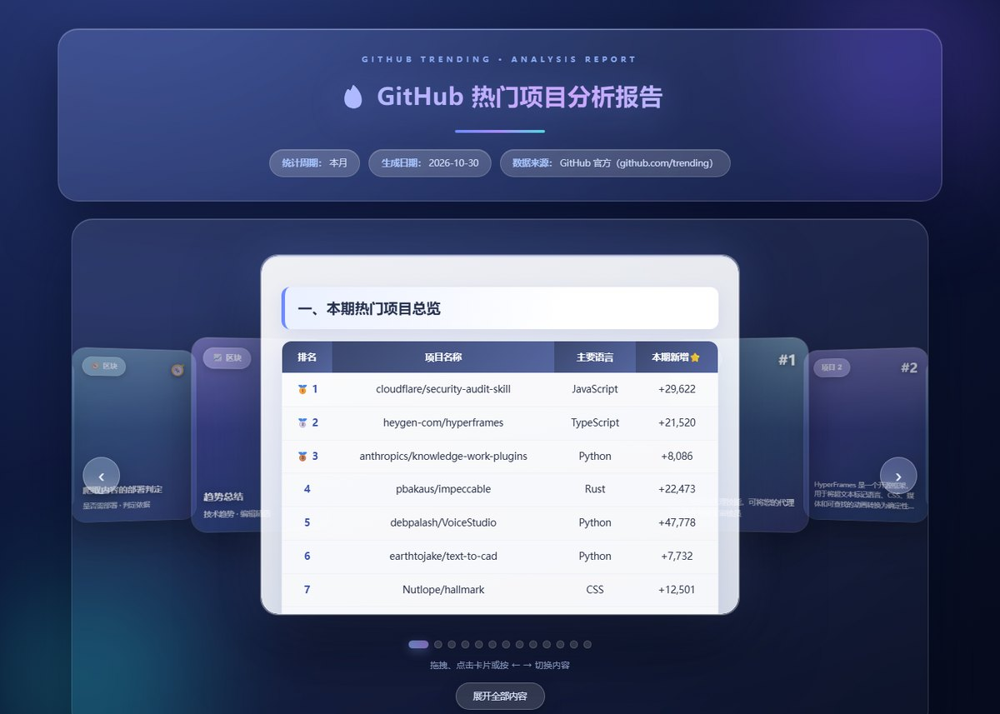
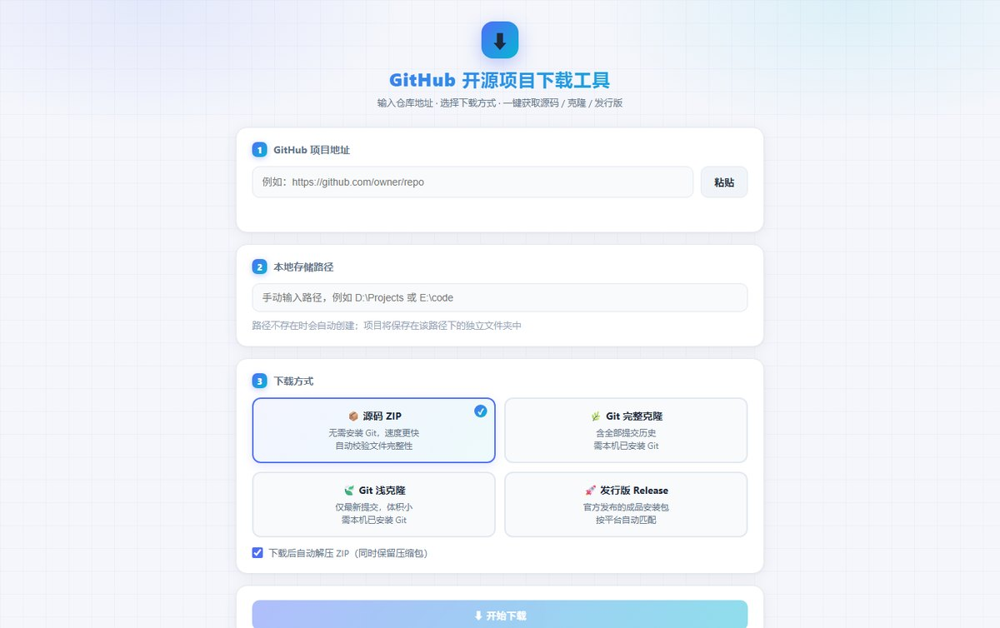

# Dangit

> **GitHub Trending → 中文深度分析报告生成器**
> 输入一个榜单周期，输出一份可以直接阅读、分发、归档的中文技术报告。

一个**零依赖**的本地 Web 工具：抓取 GitHub Trending（日 / 周 / 月 / 自定义日期）→ 拉取仓库元数据与 README → 自动英译中 → 逐项目「七问」深度分析 → 生成 Markdown + HTML 双格式报告。

全程在 `127.0.0.1` 本地运行，不需要数据库、不需要构建步骤、不需要联网账号。

---

## 界面预览

**主控制台** — 左侧选榜单周期，右边是你自己放的壁纸视频，点一下生成：


**生成的分析报告** — 排名总览 + 卡片轮播 + 逐项目七问深度分析：



**内置项目下载工具** — 粘仓库地址就能取源码，支持 ZIP / 完整克隆 / 浅克隆 / Release：



---

## 快速开始

```bash
# 1. 需要 Node.js 18+（推荐 20 / 22）
node -v

# 2. 启动
node server.js
#    Windows 也可以直接双击 启动.bat
```

浏览器会自动打开 `http://127.0.0.1:5215`，点 **🚀 生成分析报告** 即可。
报告写入 `reports/`（`.md` + `.html` 各一份）。关掉终端窗口即停止服务。

端口被占用时会自动顺延（5215 → 5216 → …）。

### 命令行模式

适合放进 crontab / 计划任务：

```bash
node server.js --cli --since daily
node server.js --cli --since monthly --source official
node server.js --cli --since 2026-08-01 --out reports
node server.js --cli --html-file data/trending_cache_daily.html   # 用本地页面离线出报告
```

| 参数 | 说明 |
|---|---|
| `--cli` | 无界面生成一份报告后退出 |
| `--since` | `daily` / `weekly` / `monthly` 或 `YYYY-MM-DD` |
| `--source` | `auto`（默认）/ `official`（GitHub 官方）/ `china`（国内镜像） |
| `--engine` | `auto` / `ai` / `builtin` |
| `--proxy` | 代理地址，如 `http://127.0.0.1:7890` |
| `--html-file` | 用本地保存的 Trending 页面离线生成 |
| `--out` | 报告输出目录（默认 `reports/`） |
| `--no-open` | 不自动打开浏览器 |

---

## 它解决什么问题

GitHub Trending 只有一堆仓库名和一句话简介，看不出**这个项目到底做什么、值不值得看、能不能商用**。

这个工具把每个项目拆成七个问题来回答：

| # | 问题 | 依据 |
|---|---|---|
| 1 | 背景 | 仓库主题 / 语言 / star 增长 / 组织归属 |
| 2 | 目的 | README 首段与简介要点 |
| 3 | 作用 | 功能特性段落抽取 |
| 4 | 技术 | 语言占比、依赖、架构关键词 |
| 5 | 场景 | 分类知识库匹配（`data/categories.json`） |
| 6 | 热门原因 | star 增速、发布节奏、话题热度 |
| 7 | 开源协议 | 解析 LICENSE，明确「能否二次开发 / 商用」 |

同分类项目会**轮换措辞并去重**，避免十份报告读起来一模一样。

---

## 功能一览

- **🔥 多源抓取** — GitHub 官方页优先，镜像站兜底；全部不可达时自动用离线缓存出报告并标注来源
- **🧠 内置规则引擎** — 不需要任何 API Key 就能出完整报告
- **🤖 可选 AI 增强** — 支持任何 OpenAI 兼容接口（DeepSeek / OpenAI / 通义 / 智谱），失败自动回退内置引擎
- **🌏 三级翻译** — 火山翻译（免 Key）→ Google → 内置离线词典
- **📜 协议判定** — MIT / Apache / GPL / BSD 等，明确商用边界
- **📤 批量导出** — 一键导出项目地址清单 `.csv` + `.txt`
- **⭐ 收藏对比** — 选中两个仓库并排比较完整分析
- **🕘 报告历史** — 列出 `reports/` 全部报告，一键打开 / 删除
- **⏰ 定时报告** — 写入 Windows 计划任务，程序关闭也照常执行
- **🔌 连通性检测** — 并行探测所有数据源并显示耗时
- **🌐 中英切换** — 界面一键切换，偏好本地保存
- **📦 下载工具** — 内置 `xxt/`，一键拉起 GitHub 项目下载器（ZIP / git clone / 浅克隆，带进度）
- **🚀 一键部署** — 本地路径部署（环境检测 → 装依赖 → 构建 → 落位 → 校验）或 Coolify 远程部署
- **🤖 AI 部署** — 把 clone / 装依赖 / 构建 / 启动校验交给 DeepSeek Harness 自主完成，过程实时可见

---

## 目录结构

```
Dangit/
├─ index.html        界面（单文件，内联样式与脚本）
├─ server.js         HTTP 服务 / JSON API / 报告历史 / 导出 / 定时 / CLI
├─ engine.js         抓榜解析 / 元数据与 README / 翻译 / 七问分析 / 报告生成
├─ localdeploy.js    本地部署：解析 → 路径校验 → 环境检测 → 装依赖 → 构建 → 落位
├─ coolify.js        Coolify 远程部署：建项目 → 设地址 → 部署 → 轮询状态
├─ aideploy.js       AI 部署：驱动 dsh headless 执行
├─ deploy-guide.html 本地部署说明
├─ 启动.bat          Windows 一键启动（纯 ASCII）
├─ config.example.json  配置模板 → 复制为 config.json 后修改
├─ coolify/          Coolify 部署文档
├─ data/             规则与可编辑数据
│  ├─ categories.json   分类模板（关键词 + 七问文案）
│  ├─ kb_projects.json  项目知识库（命中直接用人工调研文案）
│  ├─ dict_terms.json   离线英汉词典
│  └─ mirrors.json      榜单源 / README 通道 / 链接模板
├─ reports/          生成的报告
└─ xxt/              内置 GitHub 项目下载工具（独立 Node 服务，端口 5210）
```

---

## 配置

复制模板后修改，**不要提交 `config.json`**（它含你的 API Key 与 Token，已在 `.gitignore` 中）：

```bash
cp config.example.json config.json
```

| 字段 | 默认 | 说明 |
|---|---|---|
| `proxy` | `""` | HTTP 代理，如 `http://127.0.0.1:7890`；留空自动探测系统代理 |
| `since` | `monthly` | 默认榜单周期 |
| `engine` | `auto` | `auto` 有 Key 用 AI / `ai` 仅 AI / `builtin` 仅内置引擎 |
| `api_base` | `https://api.deepseek.com` | OpenAI 兼容接口地址 |
| `api_model` | `deepseek-chat` | 模型名 |
| `api_key` | `""` | 仅存本机，不会上传，接口只回传掩码 |
| `top_n` | `10` | 每期报告项目数（5 ~ 30） |
| `source_mode` | `auto` | `auto` / `official` / `china` |
| `coolify.api_token` | `""` | Coolify API Token，仅存本机，不下发给浏览器 |
| `ai_deploy.permission_mode` | `danger-full-access` | 子进程 `DSH_PERMISSION_MODE`；headless 无审批弹窗，受限模式会卡住 |

---

## 二次开发

**不改代码就能扩展**——改完刷新页面立即生效：

- `data/kb_projects.json` — 项目知识库，命中则直接使用你的调研文案
- `data/categories.json` — 分类关键词与七问措辞
- `data/dict_terms.json` — 离线词典
- `data/mirrors.json` — 榜单源、README 通道、链接模板

**改代码**：`engine.js` 按「网络层 → 抓榜 → 元数据/README → 翻译 → 内置分析 → AI 分析 → 报告生成」分区，带中文注释；`server.js` 集中所有 HTTP API。报告渲染统一走 `buildReportMd()` / `mdToHtml()`，改模板只需动这两处。

### 主要 API

| 方法 | 路径 | 说明 |
|---|---|---|
| GET | `/api/state` | 配置 + 报告列表 + 最近报告 |
| POST | `/api/generate` | 启动生成任务 `{since, sourceMode}` |
| GET | `/api/job?from=N` | 轮询日志 / 进度 / 结果 |
| POST | `/api/cancel` | 取消当前任务 |
| POST | `/api/open-tool` | 拉起 `xxt/` 下载工具 |
| POST | `/api/compare` | 收藏对比 |
| GET/POST | `/api/coolify/*` | Coolify 部署相关 |
| GET/POST | `/api/aideploy/*` | AI 部署相关 |

---

## 说明

- 所有数据抓取都在**本机发起**，没有任何遥测上报。
- 抓取的是 GitHub 公开页面，请自行遵守目标站点的使用条款，控制频率。
- 代码与报告生成结果仅供技术研究与信息汇总，报告中的分析为**自动生成**，涉及商用决策请自行核实原始仓库协议。
- 内置的第三方文档（`coolify/assets/`）与下载工具（`xxt/`）版权归各自作者。

---

## License

[MIT](LICENSE)
